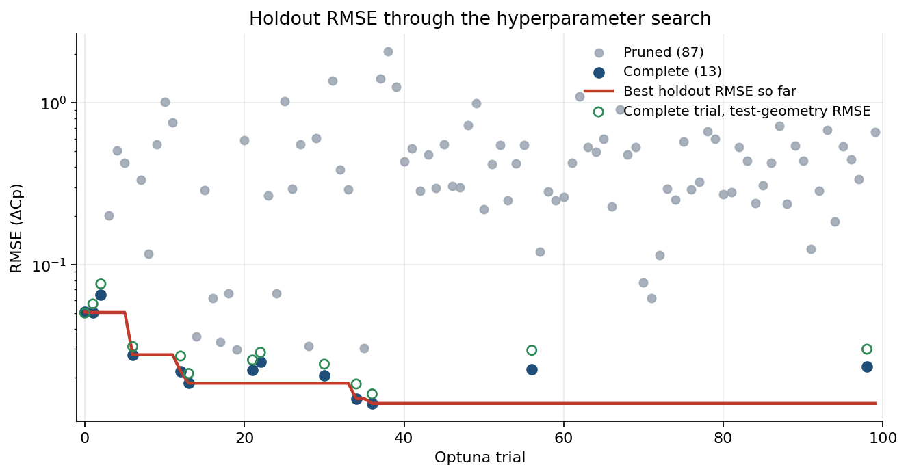
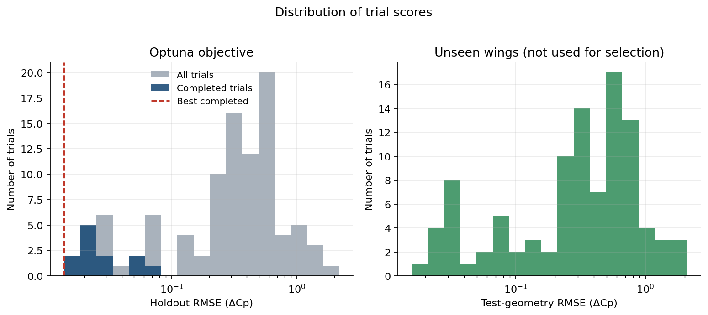
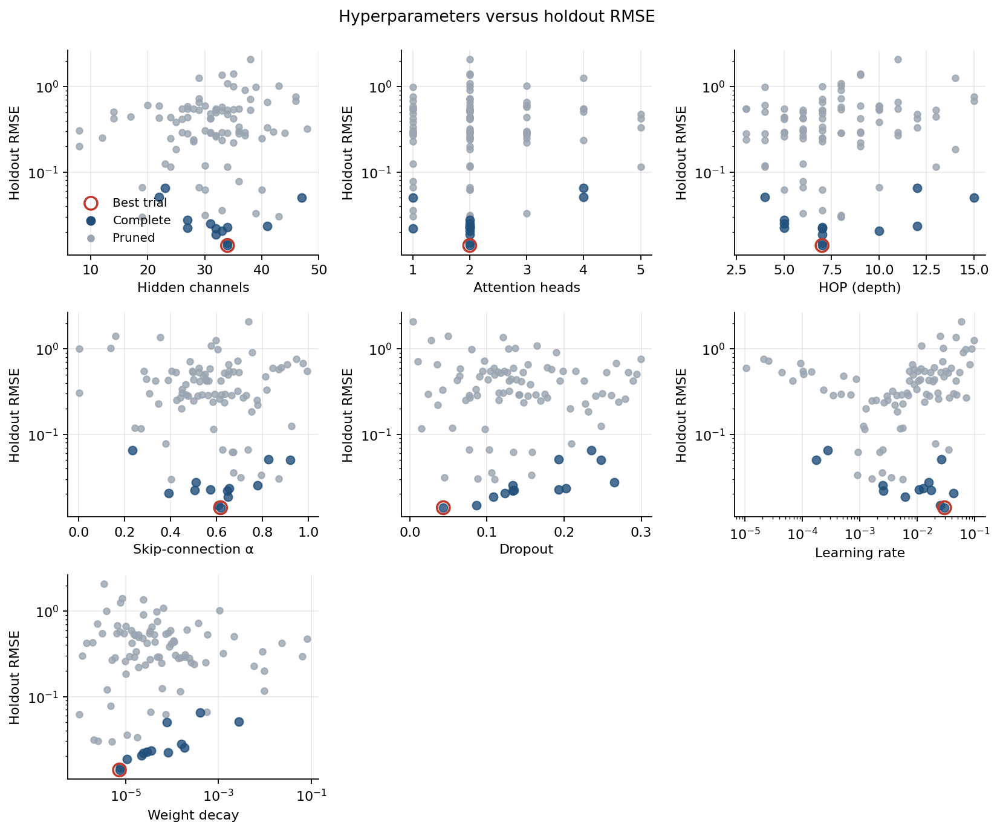
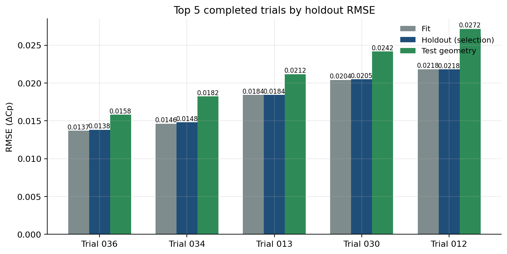
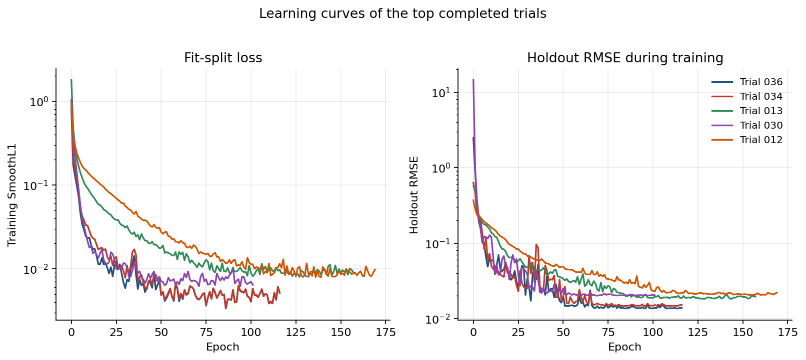
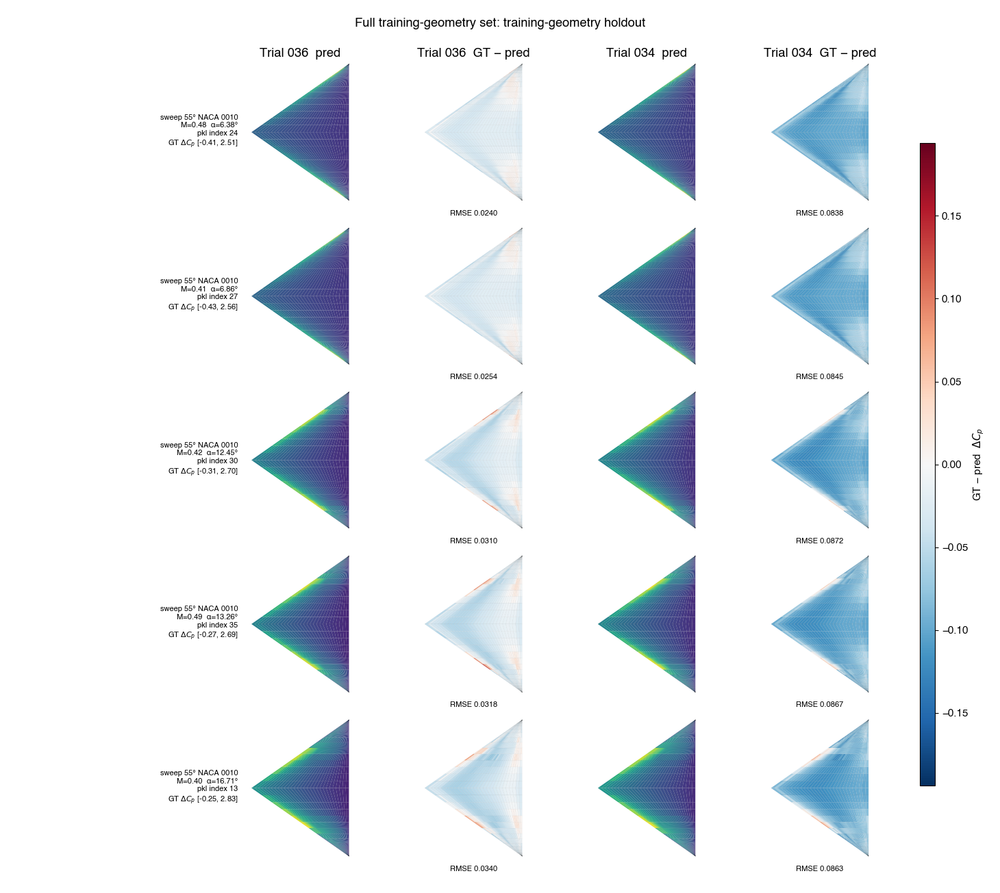
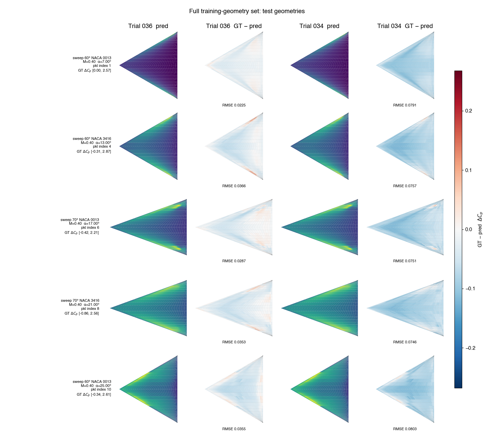

# Hyperparameter search report: Full training-geometry set

Study `hf_autoregressor` from `optuna_results`. Optuna minimized **holdout RMSE** on the random split of the training geometries. The sweep-60/70 wings in `dataset/new_geom` were scored after each trial and were **not** used for backpropagation or model selection.

## Search setup

- Trials launched: **100** (13 complete, 87 pruned)
- Mode recorded in the study: `full`
- Objective: `training_geometry_holdout.rmse`
- Checkpoint inside a trial: lowest training SmoothL1 on the fit split
- Fit / holdout / test-geometry cases: 420 / 180 / 44

Searched hyperparameters: `hidden_channels`, `heads`, `hop`, `alpha`, `dropout`, `learning_rate`, `weight_decay`.

## Outcome

Best trial: **036** (state `COMPLETE`, 117 epochs, 233961 parameters).

| Split | RMSE | NRMSE(std) | MAE |
|---|---:|---:|---:|
| Fit (80% training geometries) | 0.013694 | 0.028481 | 0.008815 |
| Holdout (selection metric) | 0.013831 | 0.028478 | 0.008748 |
| Test geometries (unseen wings) | 0.015805 | 0.031314 | 0.010117 |

Best-trial hyperparameters:

| Parameter | Value |
|---|---|
| hidden_channels | 34 |
| heads | 2 |
| hop | 7 |
| alpha | 0.617656 |
| dropout | 0.043488 |
| learning_rate | 0.02978 |
| weight_decay | 7.342e-06 |

## Optimization history

Each point is one Optuna trial. The red line is the best holdout RMSE seen so far. Open green markers are the test-geometry RMSE of completed trials; they are shown only as a diagnostic and do not choose the study winner. The vertical axis is logarithmic because a few pruned trials diverged.

## Score distribution

The left panel is the Optuna objective. The right panel is the same trials scored on the unseen test geometries.

## Hyperparameter effects

Each panel plots one searched parameter against holdout RMSE. Completed trials are darker; the best trial is ringed in red. Learning rate and weight decay are shown on a log scale.

## Top 5 completed trials

Ranking uses holdout RMSE only. Test-geometry RMSE is reported beside it so generalization can be compared without changing the ranking.

| Rank | Trial | Epochs | Params | Holdout RMSE | Test RMSE | Fit RMSE | hidden | heads | hop | α | dropout | lr | weight decay |
|---:|---:|---:|---:|---:|---:|---:|---:|---:|---:|---:|---:|---:|---:|
| 1 | 036 | 117 | 233961 | 0.013831 | 0.015805 | 0.013694 | 34 | 2 | 7 | 0.618 | 0.043 | 0.02978 | 7.342e-06 |
| 2 | 034 | 117 | 233961 | 0.014806 | 0.018227 | 0.014626 | 34 | 2 | 7 | 0.609 | 0.087 | 0.025186 | 7.627e-06 |
| 3 | 013 | 158 | 199207 | 0.018442 | 0.021184 | 0.018426 | 32 | 2 | 7 | 0.649 | 0.108 | 0.006077 | 1.057e-05 |
| 4 | 030 | 102 | 249982 | 0.020488 | 0.024179 | 0.020426 | 33 | 2 | 10 | 0.391 | 0.123 | 0.042859 | 2.196e-05 |
| 5 | 012 | 170 | 95559 | 0.021814 | 0.027167 | 0.021831 | 32 | 1 | 7 | 0.646 | 0.134 | 0.002583 | 2.382e-05 |

The learning curves below are the per-epoch records stored with each trial. The kept checkpoint is still the lowest training SmoothL1, not the lowest point on the holdout curve.

## Pressure-field snapshots

The same ten cases are plotted in both the full-set and the 55° NACA 0010 reports. The five training-geometry cases are the intersection of the two studies' holdout splits. The five test-geometry cases come from `dataset/new_geom` and were not used to train or to select either model. Each row is one case. Columns are predicted ΔCp and error (ground truth − prediction) for the top two completed trials. Predicted fields use that case's ground-truth ΔCp range. Error uses one symmetric scale per figure, shared across both reports.

### Training-geometry holdout

| # | Geometry | Source pickle | Index in pickle | test_number | Mach | AoA [deg] | Re |
|---:|---|---|---:|---:|---:|---:|---:|
| 1 | sweep 55° NACA 0010 | `pklData_deltawing_sweep_55_naca_0010.pkl` | 24 | 25 | 0.48 | 6.38 | 6.670e+06 |
| 2 | sweep 55° NACA 0010 | `pklData_deltawing_sweep_55_naca_0010.pkl` | 27 | 28 | 0.41 | 6.86 | 6.550e+06 |
| 3 | sweep 55° NACA 0010 | `pklData_deltawing_sweep_55_naca_0010.pkl` | 30 | 31 | 0.42 | 12.45 | 9.860e+06 |
| 4 | sweep 55° NACA 0010 | `pklData_deltawing_sweep_55_naca_0010.pkl` | 35 | 36 | 0.49 | 13.26 | 8.160e+06 |
| 5 | sweep 55° NACA 0010 | `pklData_deltawing_sweep_55_naca_0010.pkl` | 13 | 14 | 0.4 | 16.71 | 9.370e+06 |

### Test geometries

| # | Geometry | Source pickle | Index in pickle | test_number | Mach | AoA [deg] | Re |
|---:|---|---|---:|---:|---:|---:|---:|
| 1 | sweep 60° NACA 0013 | `pklData_deltawing_sweep_60_naca_0013_validation.pkl` | 1 | 2 | 0.4 | 7 | 7.000e+06 |
| 2 | sweep 60° NACA 3416 | `pklData_deltawing_sweep_60_naca_3416_validation.pkl` | 4 | 5 | 0.4 | 13 | 7.000e+06 |
| 3 | sweep 70° NACA 0013 | `pklData_deltawing_sweep_70_naca_0013_validation.pkl` | 6 | 7 | 0.4 | 17 | 7.000e+06 |
| 4 | sweep 70° NACA 3416 | `pklData_deltawing_sweep_70_naca_3416_validation.pkl` | 8 | 9 | 0.4 | 21 | 7.000e+06 |
| 5 | sweep 60° NACA 0013 | `pklData_deltawing_sweep_60_naca_0013_validation.pkl` | 10 | 11 | 0.4 | 25 | 7.000e+06 |

## Best trial on unseen geometries

Per-file RMSE on `dataset/new_geom`. These wings were not in the training split and were not used to pick the trial.

| Geometry file | RMSE | NRMSE(std) | MAE | Cases |
|---|---:|---:|---:|---:|
| `pklData_deltawing_sweep_60_naca_0013_validation.pkl` | 0.011366 | 0.025141 | 0.008381 | 11 |
| `pklData_deltawing_sweep_60_naca_3416_validation.pkl` | 0.016278 | 0.030765 | 0.010541 | 11 |
| `pklData_deltawing_sweep_70_naca_0013_validation.pkl` | 0.014762 | 0.030617 | 0.010398 | 11 |
| `pklData_deltawing_sweep_70_naca_3416_validation.pkl` | 0.019674 | 0.038423 | 0.011146 | 11 |

## Files

- Trial table: `trials.csv`
- Study summary: `/Users/yirenshen/Desktop/MF-VortexNet/VortexNet/hf_autoregressor/optuna_results/study_summary.json`
- Best checkpoint: `/Users/yirenshen/Desktop/MF-VortexNet/VortexNet/hf_autoregressor/optuna_results/best/model.pt`
- Field-case identities: `field_cases.json`
