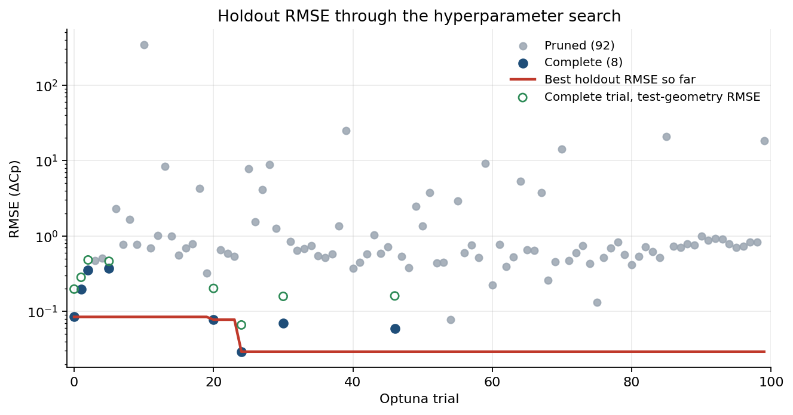
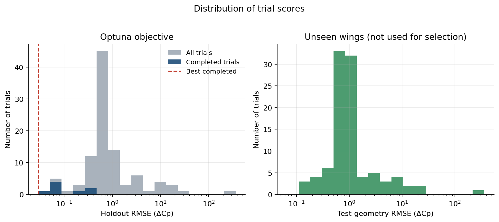
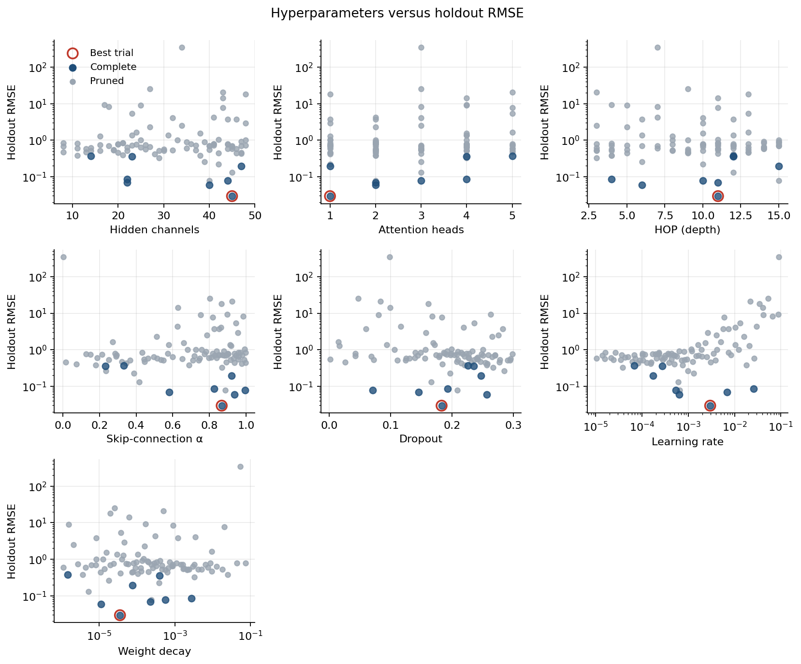
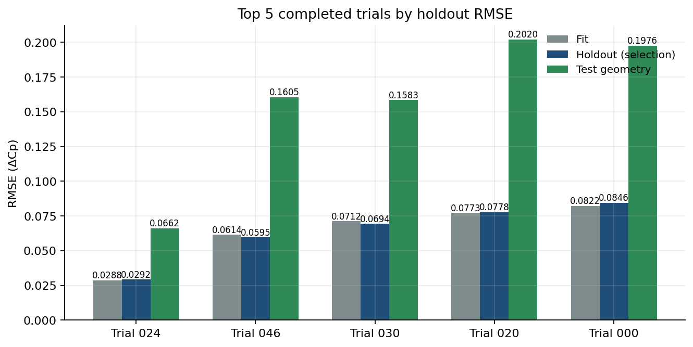
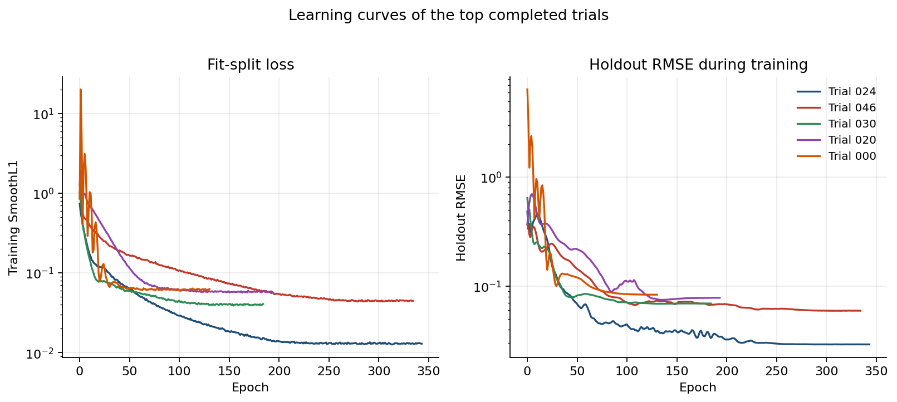
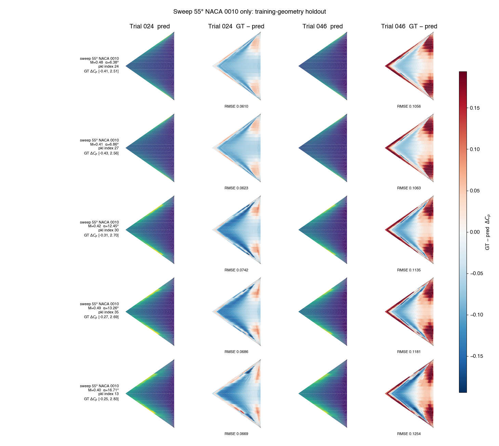
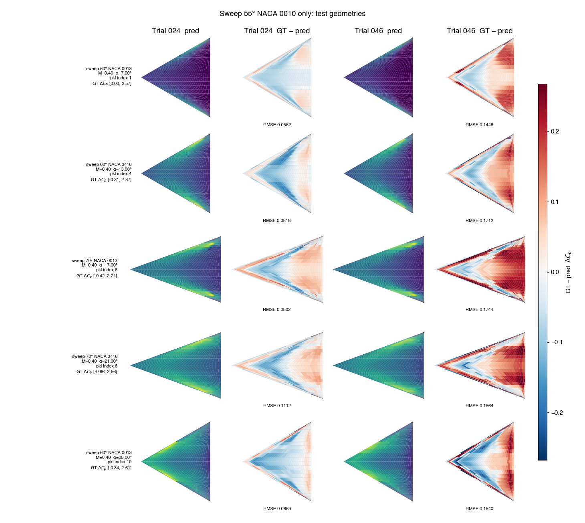

# Hyperparameter search report: Sweep 55° NACA 0010 only

Study `hf_sweep55_naca0010` from `optuna_results_550010`. Optuna minimized **holdout RMSE** on the random split of the training geometries. The sweep-60/70 wings in `dataset/new_geom` were scored after each trial and were **not** used for backpropagation or model selection.

## Search setup

- Trials launched: **100** (8 complete, 92 pruned)
- Mode recorded in the study: `full`
- Objective: `training_geometry_holdout.rmse`
- Checkpoint inside a trial: lowest training SmoothL1 on the fit split
- Fit / holdout / test-geometry cases: 28 / 12 / 44

Searched hyperparameters: `hidden_channels`, `heads`, `hop`, `alpha`, `dropout`, `learning_rate`, `weight_decay`.

## Outcome

Best trial: **024** (state `COMPLETE`, 344 epochs, 266227 parameters).

| Split | RMSE | NRMSE(std) | MAE |
|---|---:|---:|---:|
| Fit (80% training geometries) | 0.028772 | 0.06394 | 0.021241 |
| Holdout (selection metric) | 0.029243 | 0.064499 | 0.021422 |
| Test geometries (unseen wings) | 0.066163 | 0.131092 | 0.040387 |

Best-trial hyperparameters:

| Parameter | Value |
|---|---|
| hidden_channels | 45 |
| heads | 1 |
| hop | 11 |
| alpha | 0.867416 |
| dropout | 0.18316 |
| learning_rate | 0.002971 |
| weight_decay | 3.539e-05 |

## Optimization history

Each point is one Optuna trial. The red line is the best holdout RMSE seen so far. Open green markers are the test-geometry RMSE of completed trials; they are shown only as a diagnostic and do not choose the study winner. The vertical axis is logarithmic because a few pruned trials diverged.

## Score distribution

The left panel is the Optuna objective. The right panel is the same trials scored on the unseen test geometries.

## Hyperparameter effects

Each panel plots one searched parameter against holdout RMSE. Completed trials are darker; the best trial is ringed in red. Learning rate and weight decay are shown on a log scale.

## Top 5 completed trials

Ranking uses holdout RMSE only. Test-geometry RMSE is reported beside it so generalization can be compared without changing the ranking.

| Rank | Trial | Epochs | Params | Holdout RMSE | Test RMSE | Fit RMSE | hidden | heads | hop | α | dropout | lr | weight decay |
|---:|---:|---:|---:|---:|---:|---:|---:|---:|---:|---:|---:|---:|---:|
| 1 | 024 | 344 | 266227 | 0.029243 | 0.066163 | 0.028772 | 45 | 1 | 11 | 0.867 | 0.183 | 0.002971 | 3.539e-05 |
| 2 | 046 | 335 | 345167 | 0.059536 | 0.160458 | 0.061381 | 40 | 2 | 6 | 0.936 | 0.256 | 6.302e-04 | 1.121e-05 |
| 3 | 030 | 185 | 95773 | 0.069409 | 0.15833 | 0.071203 | 22 | 2 | 11 | 0.581 | 0.145 | 0.006794 | 2.280e-04 |
| 4 | 020 | 194 | 873055 | 0.077783 | 0.202038 | 0.077294 | 44 | 3 | 10 | 0.996 | 0.071 | 5.323e-04 | 5.668e-04 |
| 5 | 000 | 131 | 129697 | 0.084572 | 0.197583 | 0.082249 | 22 | 4 | 4 | 0.827 | 0.193 | 0.025989 | 0.002759 |

The learning curves below are the per-epoch records stored with each trial. The kept checkpoint is still the lowest training SmoothL1, not the lowest point on the holdout curve.

## Pressure-field snapshots

The same ten cases are plotted in both the full-set and the 55° NACA 0010 reports. The five training-geometry cases are the intersection of the two studies' holdout splits. The five test-geometry cases come from `dataset/new_geom` and were not used to train or to select either model. Each row is one case. Columns are predicted ΔCp and error (ground truth − prediction) for the top two completed trials. Predicted fields use that case's ground-truth ΔCp range. Error uses one symmetric scale per figure, shared across both reports.

### Training-geometry holdout

| # | Geometry | Source pickle | Index in pickle | test_number | Mach | AoA [deg] | Re |
|---:|---|---|---:|---:|---:|---:|---:|
| 1 | sweep 55° NACA 0010 | `pklData_deltawing_sweep_55_naca_0010.pkl` | 24 | 25 | 0.48 | 6.38 | 6.670e+06 |
| 2 | sweep 55° NACA 0010 | `pklData_deltawing_sweep_55_naca_0010.pkl` | 27 | 28 | 0.41 | 6.86 | 6.550e+06 |
| 3 | sweep 55° NACA 0010 | `pklData_deltawing_sweep_55_naca_0010.pkl` | 30 | 31 | 0.42 | 12.45 | 9.860e+06 |
| 4 | sweep 55° NACA 0010 | `pklData_deltawing_sweep_55_naca_0010.pkl` | 35 | 36 | 0.49 | 13.26 | 8.160e+06 |
| 5 | sweep 55° NACA 0010 | `pklData_deltawing_sweep_55_naca_0010.pkl` | 13 | 14 | 0.4 | 16.71 | 9.370e+06 |

### Test geometries

| # | Geometry | Source pickle | Index in pickle | test_number | Mach | AoA [deg] | Re |
|---:|---|---|---:|---:|---:|---:|---:|
| 1 | sweep 60° NACA 0013 | `pklData_deltawing_sweep_60_naca_0013_validation.pkl` | 1 | 2 | 0.4 | 7 | 7.000e+06 |
| 2 | sweep 60° NACA 3416 | `pklData_deltawing_sweep_60_naca_3416_validation.pkl` | 4 | 5 | 0.4 | 13 | 7.000e+06 |
| 3 | sweep 70° NACA 0013 | `pklData_deltawing_sweep_70_naca_0013_validation.pkl` | 6 | 7 | 0.4 | 17 | 7.000e+06 |
| 4 | sweep 70° NACA 3416 | `pklData_deltawing_sweep_70_naca_3416_validation.pkl` | 8 | 9 | 0.4 | 21 | 7.000e+06 |
| 5 | sweep 60° NACA 0013 | `pklData_deltawing_sweep_60_naca_0013_validation.pkl` | 10 | 11 | 0.4 | 25 | 7.000e+06 |

## Best trial on unseen geometries

Per-file RMSE on `dataset/new_geom`. These wings were not in the training split and were not used to pick the trial.

| Geometry file | RMSE | NRMSE(std) | MAE | Cases |
|---|---:|---:|---:|---:|
| `pklData_deltawing_sweep_60_naca_0013_validation.pkl` | 0.045852 | 0.101422 | 0.030464 | 11 |
| `pklData_deltawing_sweep_60_naca_3416_validation.pkl` | 0.062854 | 0.118794 | 0.039808 | 11 |
| `pklData_deltawing_sweep_70_naca_0013_validation.pkl` | 0.064 | 0.132735 | 0.042905 | 11 |
| `pklData_deltawing_sweep_70_naca_3416_validation.pkl` | 0.085798 | 0.167558 | 0.048373 | 11 |

## Files

- Trial table: `trials.csv`
- Study summary: `/Users/yirenshen/Desktop/MF-VortexNet/VortexNet/hf_autoregressor/optuna_results_550010/study_summary.json`
- Best checkpoint: `/Users/yirenshen/Desktop/MF-VortexNet/VortexNet/hf_autoregressor/optuna_results_550010/best/model.pt`
- Field-case identities: `field_cases.json`
