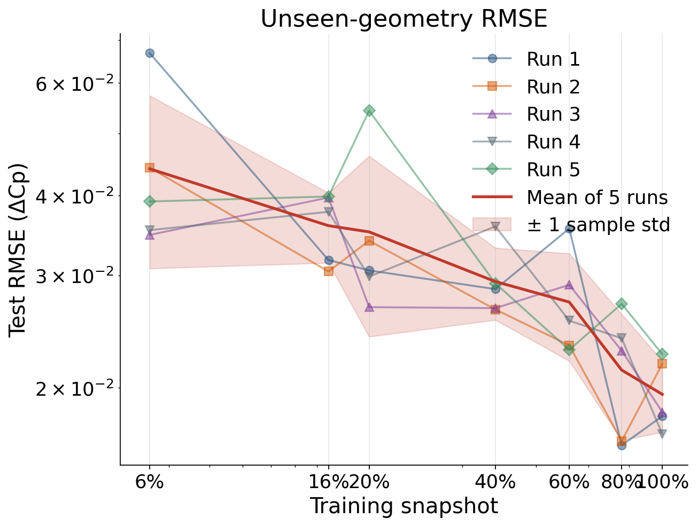
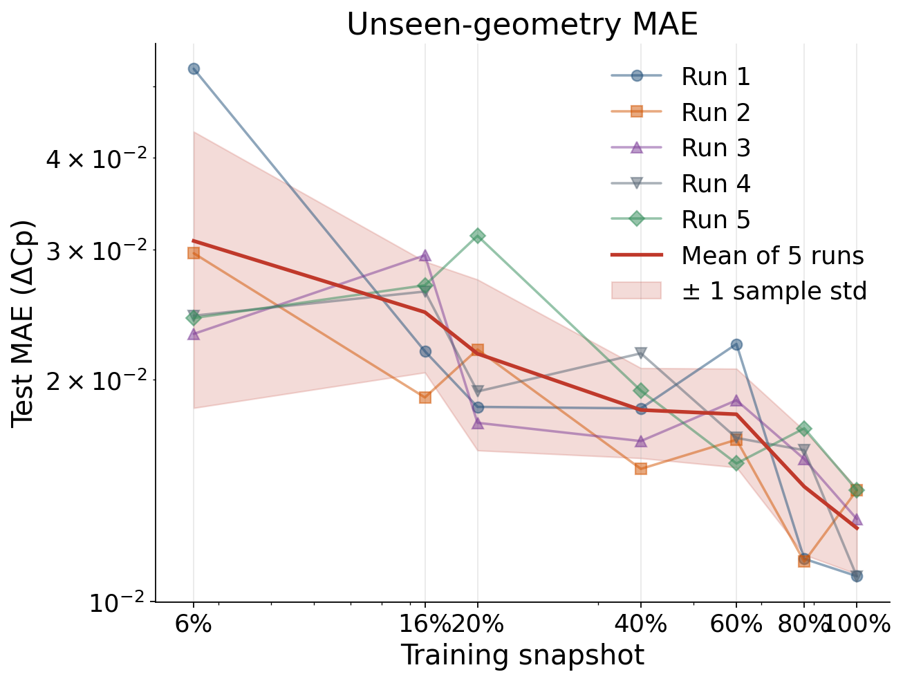
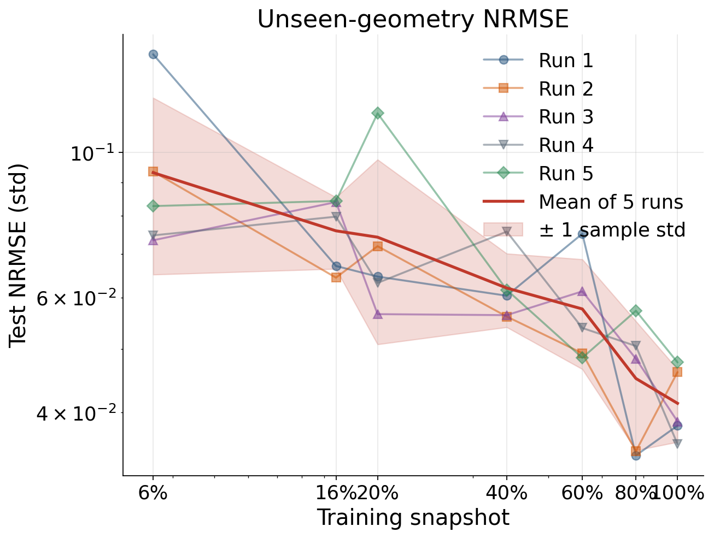

# High-fidelity autoregressor scaling

Updated 2026-11-18T21:27:48.

Each point is the Optuna winner for that nested snapshot. Optuna minimized training-geometry holdout RMSE inside the snapshot.

Test scores are on `MF-VortexNet/dataset/new_geom/lhs-free-stream` (`*_vortexNetNewGeom.pkl`). Those cases were not used for training or for selecting the checkpoint.

Runs (sorted seed order): Run 1 ← seed 7, Run 2 ← seed 27, Run 3 ← seed 207, Run 4 ← seed 353, Run 5 ← seed 3407.

## Figures

### Unseen-geometry RMSE

### Unseen-geometry MAE

### Unseen-geometry NRMSE

## Mean test error

| Snapshot | Cases | Fit / holdout | Runs | Test RMSE | Test MAE | Test NRMSE(std) |
|---:|---:|---:|---:|---:|---:|---:|
| 6% | 36 | 25 / 11 | 5 | 0.0440 ± 0.0133 | 0.0308 ± 0.0125 | 0.0931 ± 0.0281 |
| 16% | 96 | 67 / 29 | 5 | 0.0359 ± 0.0045 | 0.0247 ± 0.0042 | 0.0759 ± 0.0095 |
| 20% | 120 | 84 / 36 | 5 | 0.0351 ± 0.0110 | 0.0217 ± 0.0057 | 0.0742 ± 0.0233 |
| 40% | 240 | 168 / 72 | 5 | 0.0293 ± 0.0038 | 0.0182 ± 0.0025 | 0.0620 ± 0.0080 |
| 60% | 360 | 252 / 108 | 5 | 0.0272 ± 0.0052 | 0.0180 ± 0.0027 | 0.0576 ± 0.0110 |
| 80% | 480 | 336 / 144 | 5 | 0.0213 ± 0.0048 | 0.0143 ± 0.0027 | 0.0451 ± 0.0101 |
| 100% | 600 | 420 / 180 | 5 | 0.0195 ± 0.0025 | 0.0126 ± 0.0017 | 0.0413 ± 0.0053 |

## Test RMSE by run

| Snapshot | Run 1 | Run 2 | Run 3 | Run 4 | Run 5 |
|---:|---:|---:|---:|---:|---:|
| 6% | 0.0668 (trial 000) | 0.0442 (trial 047) | 0.0347 (trial 052) | 0.0353 (trial 062) | 0.0391 (trial 076) |
| 16% | 0.0317 (trial 096) | 0.0304 (trial 084) | 0.0397 (trial 002) | 0.0377 (trial 090) | 0.0398 (trial 064) |
| 20% | 0.0305 (trial 022) | 0.0340 (trial 016) | 0.0268 (trial 001) | 0.0299 (trial 014) | 0.0543 (trial 093) |
| 40% | 0.0285 (trial 042) | 0.0265 (trial 028) | 0.0267 (trial 007) | 0.0358 (trial 059) | 0.0291 (trial 010) |
| 60% | 0.0355 (trial 031) | 0.0233 (trial 015) | 0.0290 (trial 026) | 0.0255 (trial 052) | 0.0229 (trial 059) |
| 80% | 0.0163 (trial 027) | 0.0165 (trial 002) | 0.0229 (trial 018) | 0.0239 (trial 079) | 0.0271 (trial 049) |
| 100% | 0.0181 (trial 002) | 0.0218 (trial 061) | 0.0183 (trial 011) | 0.0169 (trial 048) | 0.0226 (trial 002) |

## Holdout / validation RMSE by run

| Snapshot | Run 1 | Run 2 | Run 3 | Run 4 | Run 5 |
|---:|---:|---:|---:|---:|---:|
| 6% | 0.0681 | 0.0462 | 0.0290 | 0.0332 | 0.0422 |
| 16% | 0.0291 | 0.0327 | 0.0400 | 0.0343 | 0.0416 |
| 20% | 0.0319 | 0.0333 | 0.0294 | 0.0270 | 0.0595 |
| 40% | 0.0306 | 0.0265 | 0.0260 | 0.0352 | 0.0310 |
| 60% | 0.0376 | 0.0232 | 0.0281 | 0.0259 | 0.0226 |
| 80% | 0.0157 | 0.0172 | 0.0216 | 0.0238 | 0.0271 |
| 100% | 0.0186 | 0.0224 | 0.0188 | 0.0172 | 0.0211 |

## Files

- Figure: `figures/test_rmse_vs_training_snapshots.png`
- Figure: `figures/test_mae_vs_training_snapshots.png`
- Figure: `figures/test_nrmse_std_vs_training_snapshots.png`
- Mean table: `seed_average.csv`
- One row per run and snapshot: `per_seed.json`

