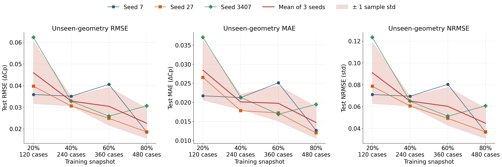

# Training-snapshot scaling, averaged over three seeds

Each point is the Optuna winner for that snapshot. Optuna minimized holdout RMSE inside the snapshot. The score plotted here is that winner's error on the 44 unseen wings in `dataset/new_geom`. Those wings were not used for training or for choosing the trial.

The three runs use nested training snapshots with seeds **7**, **27**, and **3407**. A snapshot keeps 20%, 40%, 60%, or 80% of the 600 training cases. Inside each snapshot, 30% of the kept cases are a holdout (`test_size` 0.3) and the rest are the fit split. The curve is the mean across the three seeds. The band is the sample standard deviation (n = 3).

Per-snapshot hyperparameter reports, with the search history, top trials, and pressure-field snapshots, are in `train_hf_scaling_results_seed{7,27,3407}/fraction_{20,40,60,80}/hp_search_report/`.

## Mean test error

| Snapshot | Cases | Fit / holdout | Test RMSE | Test MAE | Test NRMSE(std) |
|---:|---:|---:|---:|---:|---:|
| 20% | 120 | 84 / 36 | 0.0460 ± 0.0143 | 0.0284 ± 0.0078 | 0.0911 ± 0.0283 |
| 40% | 240 | 168 / 72 | 0.0328 ± 0.0023 | 0.0201 ± 0.0020 | 0.0651 ± 0.0045 |
| 60% | 360 | 252 / 108 | 0.0305 ± 0.0088 | 0.0198 ± 0.0047 | 0.0603 ± 0.0175 |
| 80% | 480 | 336 / 144 | 0.0226 ± 0.0070 | 0.0147 ± 0.0041 | 0.0448 ± 0.0138 |

## Test RMSE by seed

The trial number is the holdout-RMSE winner inside that study.

| Snapshot | Seed 7 | Seed 27 | Seed 3407 |
|---:|---:|---:|---:|
| 20% | 0.0359 (trial 022) | 0.0397 (trial 016) | 0.0623 (trial 093) |
| 40% | 0.0351 (trial 042) | 0.0306 (trial 028) | 0.0328 (trial 010) |
| 60% | 0.0406 (trial 031) | 0.0249 (trial 015) | 0.0259 (trial 059) |
| 80% | 0.0185 (trial 027) | 0.0186 (trial 002) | 0.0307 (trial 049) |

## Files

- Figure: `figures/test_error_vs_training_snapshots.png`
- Mean table: `seed_average.csv`
- One row per seed and snapshot: `per_seed.json`
