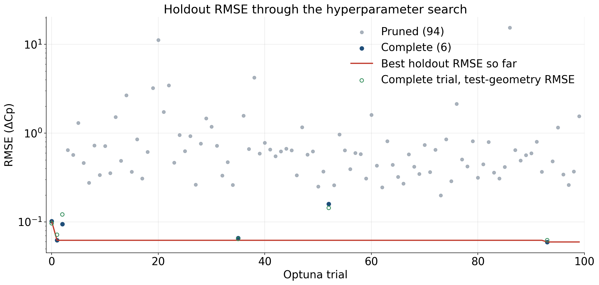
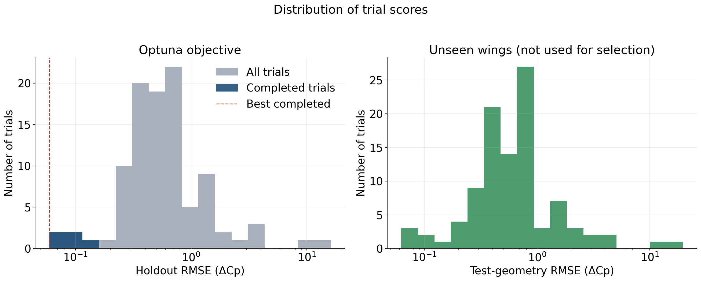
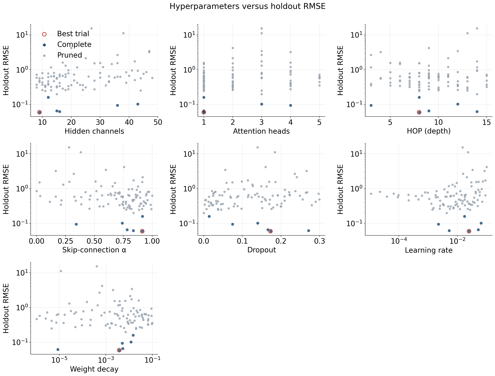
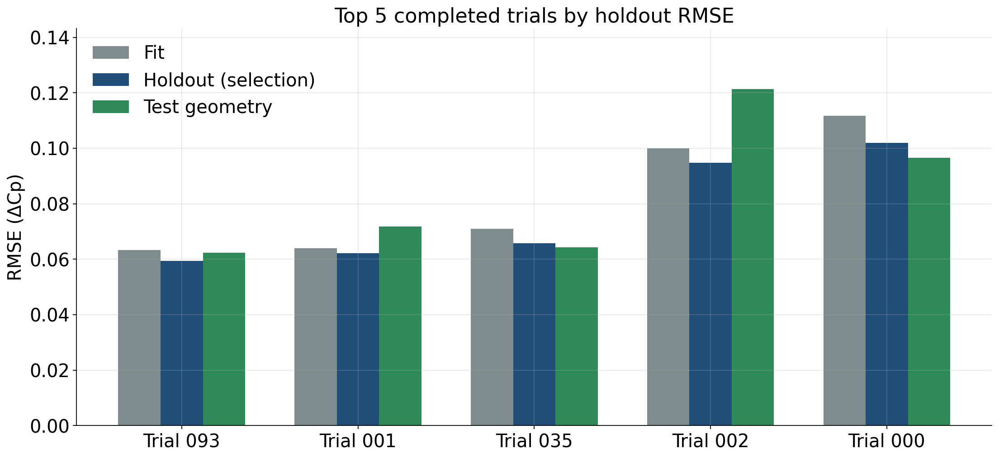
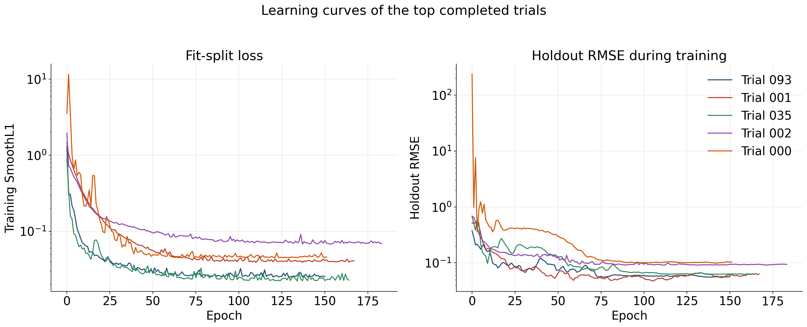
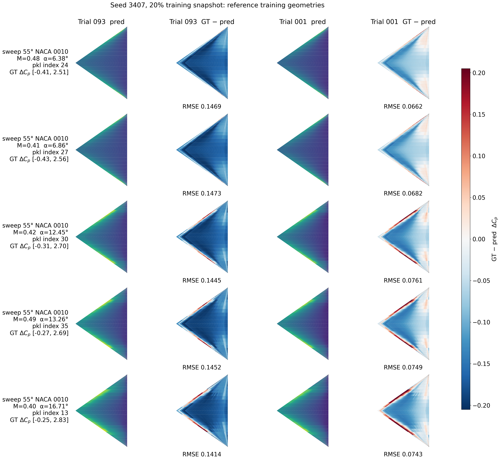
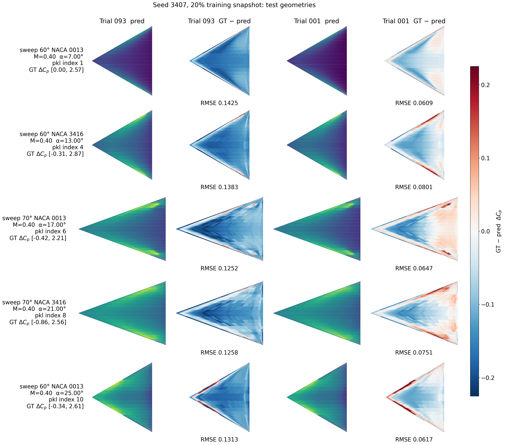

# Hyperparameter search report: Seed 3407, 20% training snapshot

Study `hf_scaling_20` from `/Users/yirenshen/Desktop/scitech27/train_hf_scaling_results_seed3407/fraction_20`. This study is the seed-3407 nested snapshot that keeps 20% of `dataset/train_set`. Optuna minimized **holdout RMSE** on the random split of the training geometries. The sweep-60/70 wings in `dataset/new_geom` were scored after each trial and were **not** used for backpropagation or model selection.

## Search setup

- Trials launched: **100** (6 complete, 94 pruned)
- Random seed for the nested snapshot and the trial training: **3407**
- Training snapshot: **20%** of the 600 training cases (120 cases; 84 fit / 36 holdout, about 70/30)
- Objective: `training_geometry_holdout.rmse`
- Checkpoint inside a trial: lowest training SmoothL1 on the fit split
- Fit / holdout / test-geometry cases: 84 / 36 / 44

Searched hyperparameters: `hidden_channels`, `heads`, `hop`, `alpha`, `dropout`, `learning_rate`, `weight_decay`.

## Outcome

Best trial: **093** (state `COMPLETE`, 151 epochs, 4408 parameters).

| Split | RMSE | NRMSE(std) | MAE |
|---|---:|---:|---:|
| Fit (70% of this snapshot) | 0.063375 | 0.132079 | 0.035503 |
| Holdout (selection metric) | 0.059493 | 0.125053 | 0.033997 |
| Test geometries (unseen wings) | 0.062301 | 0.123438 | 0.037036 |

Best-trial hyperparameters:

| Parameter | Value |
|---|---|
| hidden_channels | 9 |
| heads | 1 |
| hop | 8 |
| alpha | 0.914403 |
| dropout | 0.172723 |
| learning_rate | 0.025004 |
| weight_decay | 0.003768 |

## Optimization history

Each point is one Optuna trial. The red line is the best holdout RMSE seen so far. Open green markers are the test-geometry RMSE of completed trials; they are shown only as a diagnostic and do not choose the study winner. The vertical axis is logarithmic because a few pruned trials diverged.

## Score distribution

The left panel is the Optuna objective. The right panel is the same trials scored on the unseen test geometries.

## Hyperparameter effects

Each panel plots one searched parameter against holdout RMSE. Completed trials are darker; the best trial is ringed in red. Learning rate and weight decay are shown on a log scale.

## Top 5 completed trials

Ranking uses holdout RMSE only. Test-geometry RMSE is reported beside it so generalization can be compared without changing the ranking.

| Rank | Trial | Epochs | Params | Holdout RMSE | Test RMSE | Fit RMSE | hidden | heads | hop | α | dropout | lr | weight decay |
|---:|---:|---:|---:|---:|---:|---:|---:|---:|---:|---:|---:|---:|---:|
| 1 | 093 | 151 | 4408 | 0.059493 | 0.062301 | 0.063375 | 9 | 1 | 8 | 0.914 | 0.173 | 0.025004 | 0.003768 |
| 2 | 001 | 168 | 22087 | 0.062135 | 0.071736 | 0.064041 | 16 | 1 | 14 | 0.837 | 0.271 | 0.005258 | 8.549e-06 |
| 3 | 035 | 165 | 15217 | 0.065748 | 0.06433 | 0.070993 | 15 | 1 | 9 | 0.783 | 0.166 | 0.051736 | 0.00536 |
| 4 | 002 | 184 | 442915 | 0.094714 | 0.121356 | 0.09993 | 36 | 4 | 3 | 0.343 | 0.074 | 0.00227 | 0.005039 |
| 5 | 000 | 152 | 902104 | 0.101904 | 0.096544 | 0.111819 | 43 | 3 | 12 | 0.742 | 0.14 | 0.065027 | 0.012147 |

The learning curves below are the per-epoch records stored with each trial. The kept checkpoint is still the lowest training SmoothL1, not the lowest point on the holdout curve.

## Pressure-field snapshots

The ten cases are the same reference cases used in the October 26 full-set and 55° NACA 0010 reports, so snapshots can be compared. The five training-geometry cases are sweep 55° NACA 0010; a given case is not necessarily inside this snapshot's holdout. The five test-geometry cases come from `dataset/new_geom` and were not used to train or to select the model. Each row is one case. Columns are predicted ΔCp and error (ground truth − prediction) for the top two completed trials. Predicted fields use that case's ground-truth ΔCp range. Error uses one symmetric scale for this figure.

### Reference training-geometry cases

| # | Geometry | Source pickle | Index in pickle | test_number | Mach | AoA [deg] | Re |
|---:|---|---|---:|---:|---:|---:|---:|
| 1 | sweep 55° NACA 0010 | `pklData_deltawing_sweep_55_naca_0010.pkl` | 24 | 25 | 0.48 | 6.38 | 6.670e+06 |
| 2 | sweep 55° NACA 0010 | `pklData_deltawing_sweep_55_naca_0010.pkl` | 27 | 28 | 0.41 | 6.86 | 6.550e+06 |
| 3 | sweep 55° NACA 0010 | `pklData_deltawing_sweep_55_naca_0010.pkl` | 30 | 31 | 0.42 | 12.45 | 9.860e+06 |
| 4 | sweep 55° NACA 0010 | `pklData_deltawing_sweep_55_naca_0010.pkl` | 35 | 36 | 0.49 | 13.26 | 8.160e+06 |
| 5 | sweep 55° NACA 0010 | `pklData_deltawing_sweep_55_naca_0010.pkl` | 13 | 14 | 0.4 | 16.71 | 9.370e+06 |

### Test geometries

| # | Geometry | Source pickle | Index in pickle | test_number | Mach | AoA [deg] | Re |
|---:|---|---|---:|---:|---:|---:|---:|
| 1 | sweep 60° NACA 0013 | `pklData_deltawing_sweep_60_naca_0013_validation.pkl` | 1 | 2 | 0.4 | 7 | 7.000e+06 |
| 2 | sweep 60° NACA 3416 | `pklData_deltawing_sweep_60_naca_3416_validation.pkl` | 4 | 5 | 0.4 | 13 | 7.000e+06 |
| 3 | sweep 70° NACA 0013 | `pklData_deltawing_sweep_70_naca_0013_validation.pkl` | 6 | 7 | 0.4 | 17 | 7.000e+06 |
| 4 | sweep 70° NACA 3416 | `pklData_deltawing_sweep_70_naca_3416_validation.pkl` | 8 | 9 | 0.4 | 21 | 7.000e+06 |
| 5 | sweep 60° NACA 0013 | `pklData_deltawing_sweep_60_naca_0013_validation.pkl` | 10 | 11 | 0.4 | 25 | 7.000e+06 |

## Best trial on unseen geometries

Per-file RMSE on `dataset/new_geom`. These wings were not in the training split and were not used to pick the trial.

| Geometry file | RMSE | NRMSE(std) | MAE | Cases |
|---|---:|---:|---:|---:|
| `pklData_deltawing_sweep_60_naca_0013_validation.pkl` | 0.054437 | 0.120412 | 0.02892 | 11 |
| `pklData_deltawing_sweep_60_naca_3416_validation.pkl` | 0.063502 | 0.120018 | 0.03665 | 11 |
| `pklData_deltawing_sweep_70_naca_0013_validation.pkl` | 0.063167 | 0.131007 | 0.041955 | 11 |
| `pklData_deltawing_sweep_70_naca_3416_validation.pkl` | 0.067377 | 0.131583 | 0.040619 | 11 |

## Files

- Trial table: `trials.csv`
- Study summary: `/Users/yirenshen/Desktop/scitech27/train_hf_scaling_results_seed3407/fraction_20/study_summary.json`
- Best checkpoint: `/Users/yirenshen/Desktop/scitech27/train_hf_scaling_results_seed3407/fraction_20/best/model.pt`
- Field-case identities: `field_cases.json`
