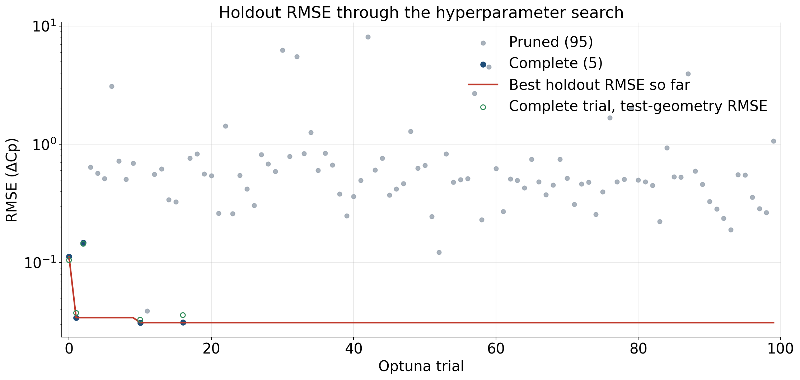
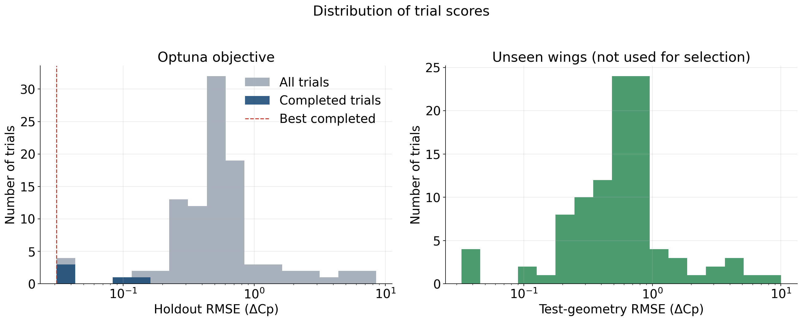
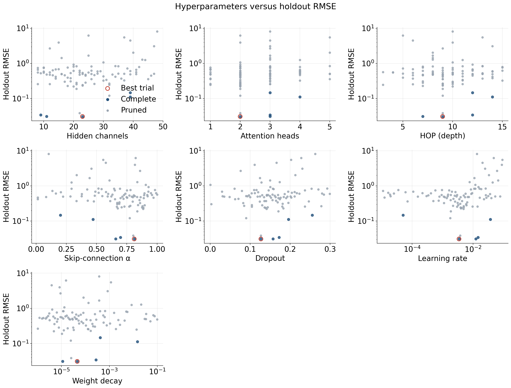
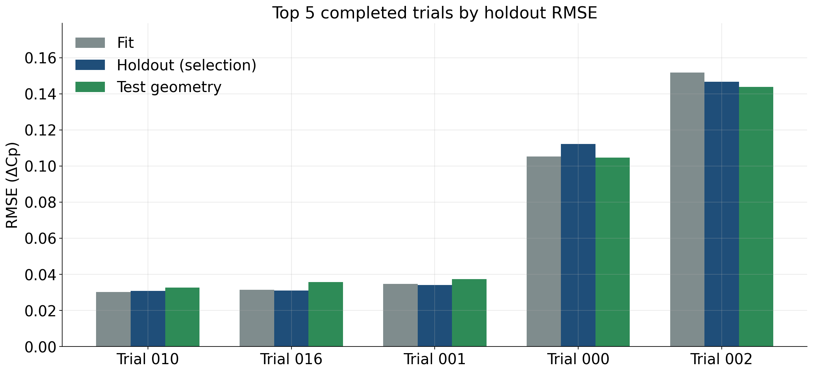
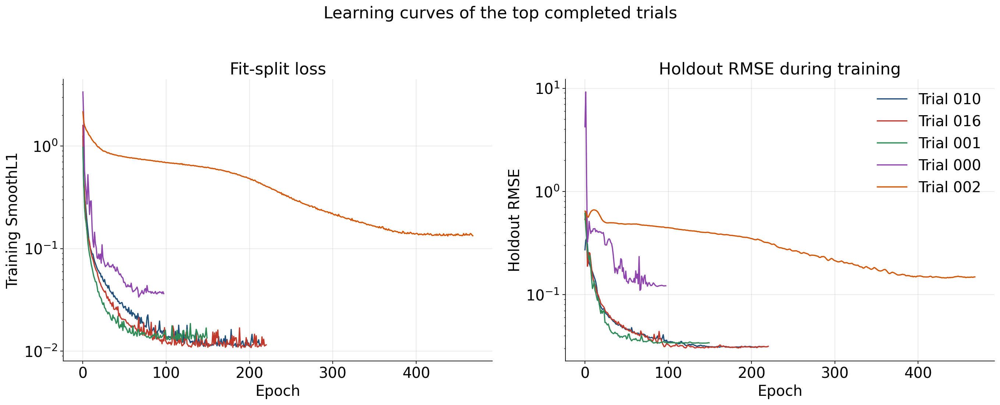
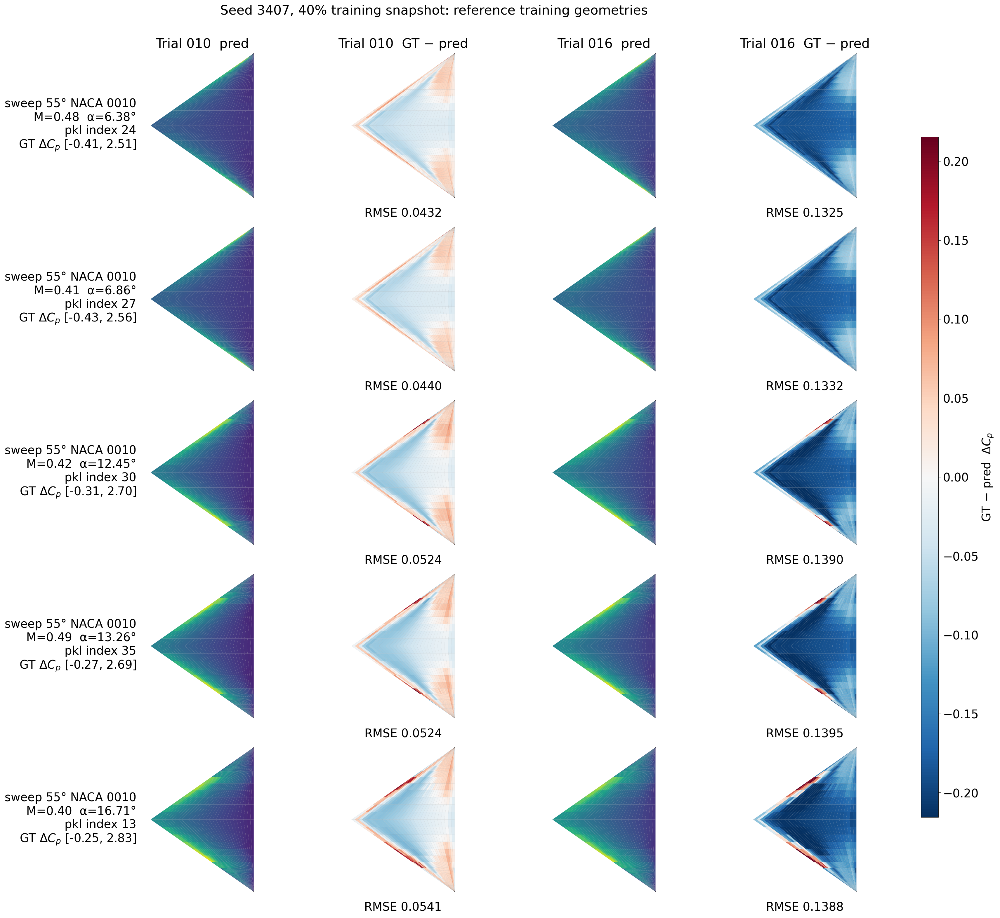
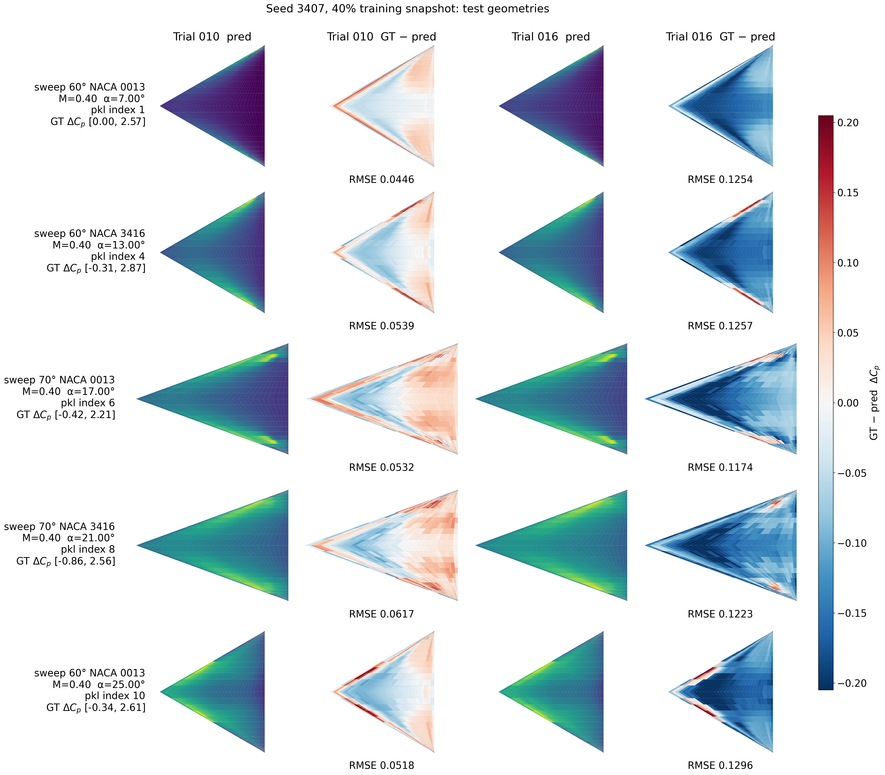

# Hyperparameter search report: Seed 3407, 40% training snapshot

Study `hf_scaling_40` from `/Users/yirenshen/Desktop/scitech27/train_hf_scaling_results_seed3407/fraction_40`. This study is the seed-3407 nested snapshot that keeps 40% of `dataset/train_set`. Optuna minimized **holdout RMSE** on the random split of the training geometries. The sweep-60/70 wings in `dataset/new_geom` were scored after each trial and were **not** used for backpropagation or model selection.

## Search setup

- Trials launched: **100** (5 complete, 95 pruned)
- Random seed for the nested snapshot and the trial training: **3407**
- Training snapshot: **40%** of the 600 training cases (240 cases; 168 fit / 72 holdout, about 70/30)
- Objective: `training_geometry_holdout.rmse`
- Checkpoint inside a trial: lowest training SmoothL1 on the fit split
- Fit / holdout / test-geometry cases: 168 / 72 / 44

Searched hyperparameters: `hidden_channels`, `heads`, `hop`, `alpha`, `dropout`, `learning_rate`, `weight_decay`.

## Outcome

Best trial: **010** (state `COMPLETE`, 215 epochs, 95526 parameters).

| Split | RMSE | NRMSE(std) | MAE |
|---|---:|---:|---:|
| Fit (70% of this snapshot) | 0.030255 | 0.062539 | 0.020052 |
| Holdout (selection metric) | 0.030978 | 0.064019 | 0.020291 |
| Test geometries (unseen wings) | 0.032789 | 0.064966 | 0.02134 |

Best-trial hyperparameters:

| Parameter | Value |
|---|---|
| hidden_channels | 23 |
| heads | 2 |
| hop | 9 |
| alpha | 0.811291 |
| dropout | 0.126838 |
| learning_rate | 0.003468 |
| weight_decay | 4.578e-05 |

## Optimization history

Each point is one Optuna trial. The red line is the best holdout RMSE seen so far. Open green markers are the test-geometry RMSE of completed trials; they are shown only as a diagnostic and do not choose the study winner. The vertical axis is logarithmic because a few pruned trials diverged.

## Score distribution

The left panel is the Optuna objective. The right panel is the same trials scored on the unseen test geometries.

## Hyperparameter effects

Each panel plots one searched parameter against holdout RMSE. Completed trials are darker; the best trial is ringed in red. Learning rate and weight decay are shown on a log scale.

## Top 5 completed trials

Ranking uses holdout RMSE only. Test-geometry RMSE is reported beside it so generalization can be compared without changing the ranking.

| Rank | Trial | Epochs | Params | Holdout RMSE | Test RMSE | Fit RMSE | hidden | heads | hop | α | dropout | lr | weight decay |
|---:|---:|---:|---:|---:|---:|---:|---:|---:|---:|---:|---:|---:|---:|
| 1 | 010 | 215 | 95526 | 0.030978 | 0.032789 | 0.030255 | 23 | 2 | 9 | 0.811 | 0.127 | 0.003468 | 4.578e-05 |
| 2 | 016 | 221 | 23833 | 0.031078 | 0.035863 | 0.031418 | 11 | 3 | 7 | 0.658 | 0.157 | 0.012447 | 1.127e-05 |
| 3 | 001 | 150 | 24496 | 0.034144 | 0.037419 | 0.034735 | 9 | 3 | 12 | 0.697 | 0.172 | 0.014571 | 2.778e-04 |
| 4 | 000 | 98 | 1168720 | 0.112163 | 0.104651 | 0.10531 | 39 | 4 | 14 | 0.47 | 0.196 | 0.037078 | 0.01478 |
| 5 | 002 | 469 | 706336 | 0.146749 | 0.143781 | 0.151775 | 39 | 3 | 12 | 0.201 | 0.255 | 4.988e-05 | 4.175e-04 |

The learning curves below are the per-epoch records stored with each trial. The kept checkpoint is still the lowest training SmoothL1, not the lowest point on the holdout curve.

## Pressure-field snapshots

The ten cases are the same reference cases used in the October 26 full-set and 55° NACA 0010 reports, so snapshots can be compared. The five training-geometry cases are sweep 55° NACA 0010; a given case is not necessarily inside this snapshot's holdout. The five test-geometry cases come from `dataset/new_geom` and were not used to train or to select the model. Each row is one case. Columns are predicted ΔCp and error (ground truth − prediction) for the top two completed trials. Predicted fields use that case's ground-truth ΔCp range. Error uses one symmetric scale for this figure.

### Reference training-geometry cases

| # | Geometry | Source pickle | Index in pickle | test_number | Mach | AoA [deg] | Re |
|---:|---|---|---:|---:|---:|---:|---:|
| 1 | sweep 55° NACA 0010 | `pklData_deltawing_sweep_55_naca_0010.pkl` | 24 | 25 | 0.48 | 6.38 | 6.670e+06 |
| 2 | sweep 55° NACA 0010 | `pklData_deltawing_sweep_55_naca_0010.pkl` | 27 | 28 | 0.41 | 6.86 | 6.550e+06 |
| 3 | sweep 55° NACA 0010 | `pklData_deltawing_sweep_55_naca_0010.pkl` | 30 | 31 | 0.42 | 12.45 | 9.860e+06 |
| 4 | sweep 55° NACA 0010 | `pklData_deltawing_sweep_55_naca_0010.pkl` | 35 | 36 | 0.49 | 13.26 | 8.160e+06 |
| 5 | sweep 55° NACA 0010 | `pklData_deltawing_sweep_55_naca_0010.pkl` | 13 | 14 | 0.4 | 16.71 | 9.370e+06 |

### Test geometries

| # | Geometry | Source pickle | Index in pickle | test_number | Mach | AoA [deg] | Re |
|---:|---|---|---:|---:|---:|---:|---:|
| 1 | sweep 60° NACA 0013 | `pklData_deltawing_sweep_60_naca_0013_validation.pkl` | 1 | 2 | 0.4 | 7 | 7.000e+06 |
| 2 | sweep 60° NACA 3416 | `pklData_deltawing_sweep_60_naca_3416_validation.pkl` | 4 | 5 | 0.4 | 13 | 7.000e+06 |
| 3 | sweep 70° NACA 0013 | `pklData_deltawing_sweep_70_naca_0013_validation.pkl` | 6 | 7 | 0.4 | 17 | 7.000e+06 |
| 4 | sweep 70° NACA 3416 | `pklData_deltawing_sweep_70_naca_3416_validation.pkl` | 8 | 9 | 0.4 | 21 | 7.000e+06 |
| 5 | sweep 60° NACA 0013 | `pklData_deltawing_sweep_60_naca_0013_validation.pkl` | 10 | 11 | 0.4 | 25 | 7.000e+06 |

## Best trial on unseen geometries

Per-file RMSE on `dataset/new_geom`. These wings were not in the training split and were not used to pick the trial.

| Geometry file | RMSE | NRMSE(std) | MAE | Cases |
|---|---:|---:|---:|---:|
| `pklData_deltawing_sweep_60_naca_0013_validation.pkl` | 0.025455 | 0.056306 | 0.016807 | 11 |
| `pklData_deltawing_sweep_60_naca_3416_validation.pkl` | 0.034426 | 0.065065 | 0.022378 | 11 |
| `pklData_deltawing_sweep_70_naca_0013_validation.pkl` | 0.03296 | 0.068358 | 0.022641 | 11 |
| `pklData_deltawing_sweep_70_naca_3416_validation.pkl` | 0.037161 | 0.072573 | 0.023534 | 11 |

## Files

- Trial table: `trials.csv`
- Study summary: `/Users/yirenshen/Desktop/scitech27/train_hf_scaling_results_seed3407/fraction_40/study_summary.json`
- Best checkpoint: `/Users/yirenshen/Desktop/scitech27/train_hf_scaling_results_seed3407/fraction_40/best/model.pt`
- Field-case identities: `field_cases.json`
