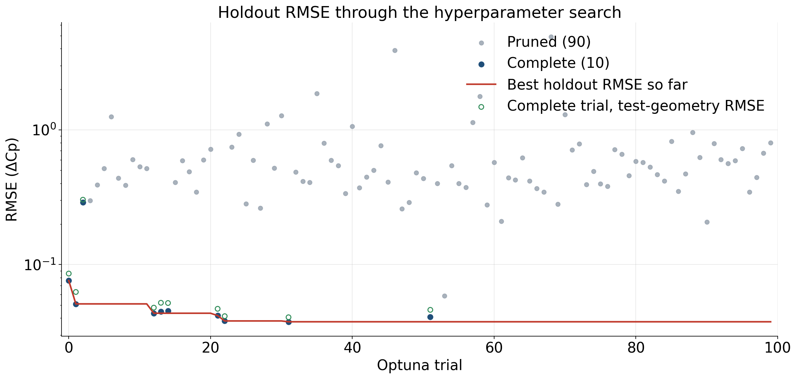
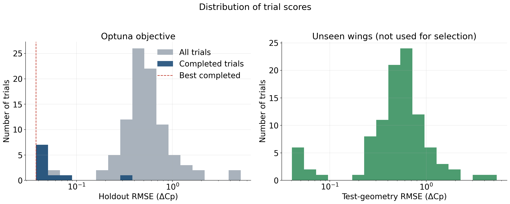
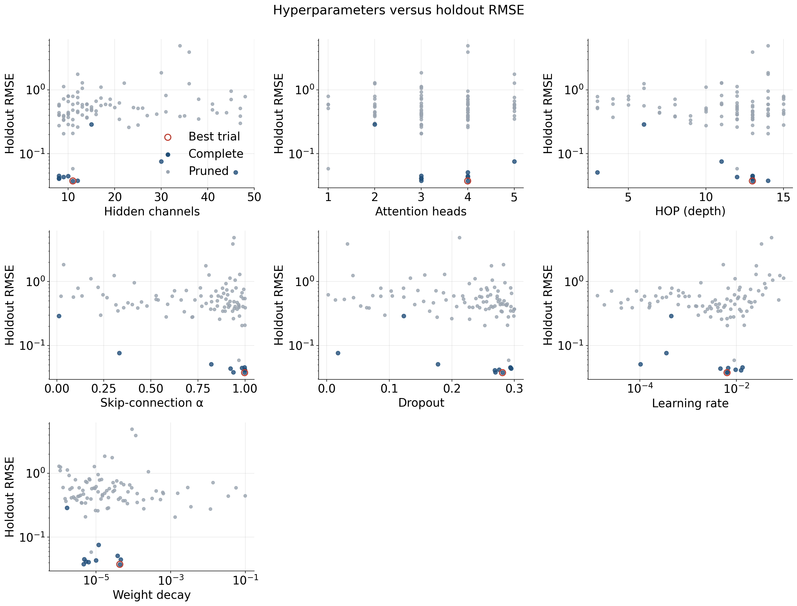
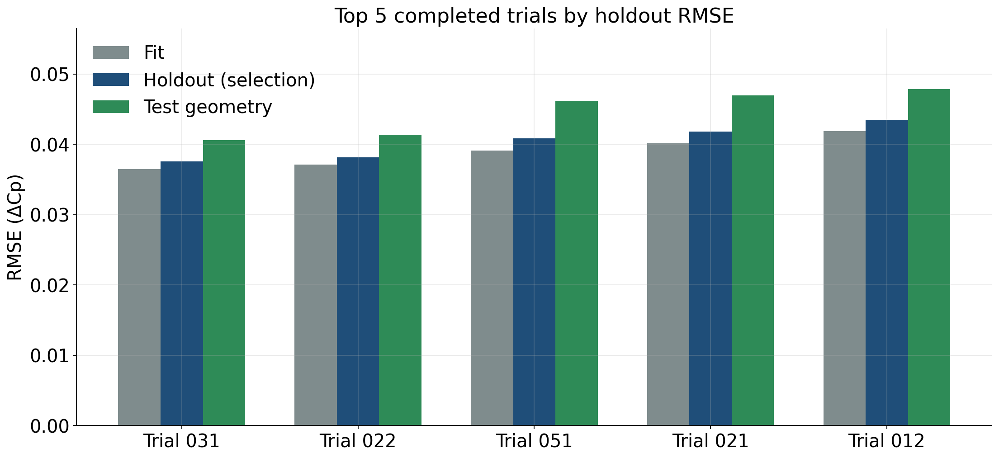
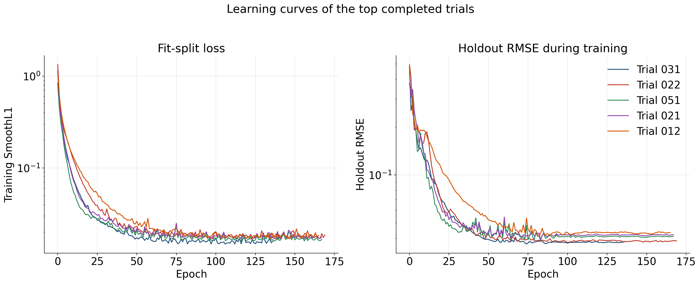
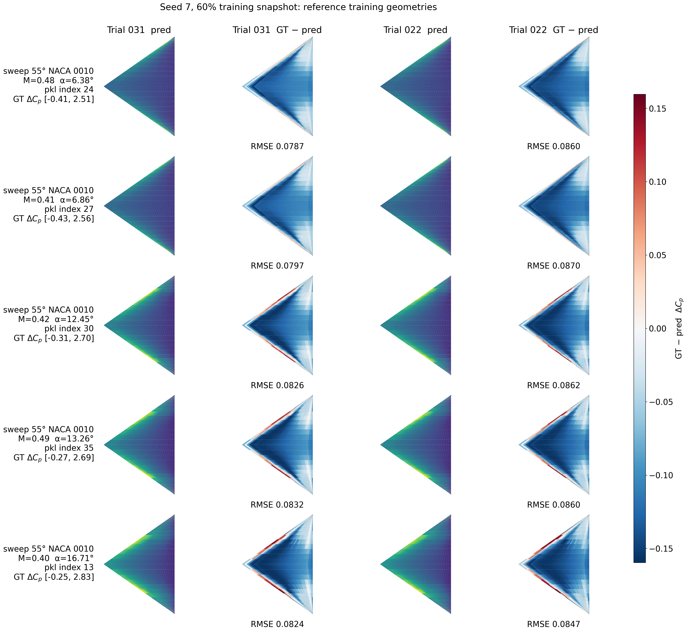
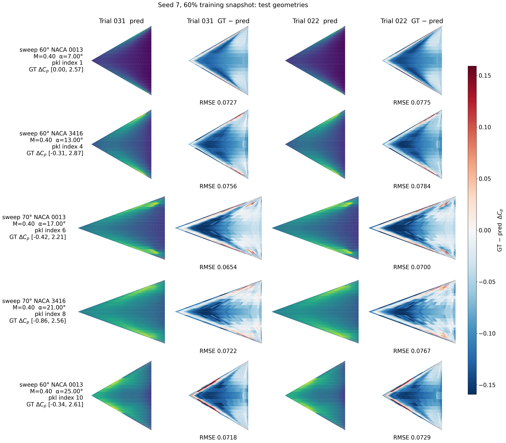

# Hyperparameter search report: Seed 7, 60% training snapshot

Study `hf_scaling_60` from `/Users/yirenshen/Desktop/scitech27/train_hf_scaling_results_seed7/fraction_60`. This study is the seed-7 nested snapshot that keeps 60% of `dataset/train_set`. Optuna minimized **holdout RMSE** on the random split of the training geometries. The sweep-60/70 wings in `dataset/new_geom` were scored after each trial and were **not** used for backpropagation or model selection.

## Search setup

- Trials launched: **100** (10 complete, 90 pruned)
- Random seed for the nested snapshot and the trial training: **7**
- Training snapshot: **60%** of the 600 training cases (360 cases; 252 fit / 108 holdout, about 70/30)
- Objective: `training_geometry_holdout.rmse`
- Checkpoint inside a trial: lowest training SmoothL1 on the fit split
- Fit / holdout / test-geometry cases: 252 / 108 / 44

Searched hyperparameters: `hidden_channels`, `heads`, `hop`, `alpha`, `dropout`, `learning_rate`, `weight_decay`.

## Outcome

Best trial: **031** (state `COMPLETE`, 137 epochs, 63840 parameters).

| Split | RMSE | NRMSE(std) | MAE |
|---|---:|---:|---:|
| Fit (70% of this snapshot) | 0.036492 | 0.077285 | 0.023035 |
| Holdout (selection metric) | 0.037599 | 0.077718 | 0.02347 |
| Test geometries (unseen wings) | 0.04061 | 0.080462 | 0.02513 |

Best-trial hyperparameters:

| Parameter | Value |
|---|---|
| hidden_channels | 11 |
| heads | 4 |
| hop | 13 |
| alpha | 0.997956 |
| dropout | 0.280936 |
| learning_rate | 0.00643 |
| weight_decay | 4.321e-05 |

## Optimization history

Each point is one Optuna trial. The red line is the best holdout RMSE seen so far. Open green markers are the test-geometry RMSE of completed trials; they are shown only as a diagnostic and do not choose the study winner. The vertical axis is logarithmic because a few pruned trials diverged.

## Score distribution

The left panel is the Optuna objective. The right panel is the same trials scored on the unseen test geometries.

## Hyperparameter effects

Each panel plots one searched parameter against holdout RMSE. Completed trials are darker; the best trial is ringed in red. Learning rate and weight decay are shown on a log scale.

## Top 5 completed trials

Ranking uses holdout RMSE only. Test-geometry RMSE is reported beside it so generalization can be compared without changing the ranking.

| Rank | Trial | Epochs | Params | Holdout RMSE | Test RMSE | Fit RMSE | hidden | heads | hop | α | dropout | lr | weight decay |
|---:|---:|---:|---:|---:|---:|---:|---:|---:|---:|---:|---:|---:|---:|
| 1 | 031 | 137 | 63840 | 0.037599 | 0.04061 | 0.036492 | 11 | 4 | 13 | 0.998 | 0.281 | 0.00643 | 4.321e-05 |
| 2 | 022 | 170 | 51775 | 0.038131 | 0.041374 | 0.037105 | 12 | 3 | 14 | 0.937 | 0.27 | 0.006489 | 4.646e-06 |
| 3 | 051 | 168 | 20647 | 0.040825 | 0.046094 | 0.039135 | 8 | 3 | 13 | 0.999 | 0.268 | 0.012473 | 6.305e-06 |
| 4 | 021 | 168 | 20647 | 0.04179 | 0.046926 | 0.040174 | 8 | 3 | 13 | 1 | 0.275 | 0.009655 | 5.371e-06 |
| 5 | 012 | 166 | 38806 | 0.043506 | 0.047856 | 0.041864 | 9 | 4 | 12 | 0.922 | 0.295 | 0.00467 | 1.000e-05 |

The learning curves below are the per-epoch records stored with each trial. The kept checkpoint is still the lowest training SmoothL1, not the lowest point on the holdout curve.

## Pressure-field snapshots

The ten cases are the same reference cases used in the October 26 full-set and 55° NACA 0010 reports, so snapshots can be compared. The five training-geometry cases are sweep 55° NACA 0010; a given case is not necessarily inside this snapshot's holdout. The five test-geometry cases come from `dataset/new_geom` and were not used to train or to select the model. Each row is one case. Columns are predicted ΔCp and error (ground truth − prediction) for the top two completed trials. Predicted fields use that case's ground-truth ΔCp range. Error uses one symmetric scale for this figure.

### Reference training-geometry cases

| # | Geometry | Source pickle | Index in pickle | test_number | Mach | AoA [deg] | Re |
|---:|---|---|---:|---:|---:|---:|---:|
| 1 | sweep 55° NACA 0010 | `pklData_deltawing_sweep_55_naca_0010.pkl` | 24 | 25 | 0.48 | 6.38 | 6.670e+06 |
| 2 | sweep 55° NACA 0010 | `pklData_deltawing_sweep_55_naca_0010.pkl` | 27 | 28 | 0.41 | 6.86 | 6.550e+06 |
| 3 | sweep 55° NACA 0010 | `pklData_deltawing_sweep_55_naca_0010.pkl` | 30 | 31 | 0.42 | 12.45 | 9.860e+06 |
| 4 | sweep 55° NACA 0010 | `pklData_deltawing_sweep_55_naca_0010.pkl` | 35 | 36 | 0.49 | 13.26 | 8.160e+06 |
| 5 | sweep 55° NACA 0010 | `pklData_deltawing_sweep_55_naca_0010.pkl` | 13 | 14 | 0.4 | 16.71 | 9.370e+06 |

### Test geometries

| # | Geometry | Source pickle | Index in pickle | test_number | Mach | AoA [deg] | Re |
|---:|---|---|---:|---:|---:|---:|---:|
| 1 | sweep 60° NACA 0013 | `pklData_deltawing_sweep_60_naca_0013_validation.pkl` | 1 | 2 | 0.4 | 7 | 7.000e+06 |
| 2 | sweep 60° NACA 3416 | `pklData_deltawing_sweep_60_naca_3416_validation.pkl` | 4 | 5 | 0.4 | 13 | 7.000e+06 |
| 3 | sweep 70° NACA 0013 | `pklData_deltawing_sweep_70_naca_0013_validation.pkl` | 6 | 7 | 0.4 | 17 | 7.000e+06 |
| 4 | sweep 70° NACA 3416 | `pklData_deltawing_sweep_70_naca_3416_validation.pkl` | 8 | 9 | 0.4 | 21 | 7.000e+06 |
| 5 | sweep 60° NACA 0013 | `pklData_deltawing_sweep_60_naca_0013_validation.pkl` | 10 | 11 | 0.4 | 25 | 7.000e+06 |

## Best trial on unseen geometries

Per-file RMSE on `dataset/new_geom`. These wings were not in the training split and were not used to pick the trial.

| Geometry file | RMSE | NRMSE(std) | MAE | Cases |
|---|---:|---:|---:|---:|
| `pklData_deltawing_sweep_60_naca_0013_validation.pkl` | 0.033765 | 0.074687 | 0.020145 | 11 |
| `pklData_deltawing_sweep_60_naca_3416_validation.pkl` | 0.040816 | 0.077142 | 0.025446 | 11 |
| `pklData_deltawing_sweep_70_naca_0013_validation.pkl` | 0.039589 | 0.082107 | 0.026603 | 11 |
| `pklData_deltawing_sweep_70_naca_3416_validation.pkl` | 0.047153 | 0.092087 | 0.028324 | 11 |

## Files

- Trial table: `trials.csv`
- Study summary: `/Users/yirenshen/Desktop/scitech27/train_hf_scaling_results_seed7/fraction_60/study_summary.json`
- Best checkpoint: `/Users/yirenshen/Desktop/scitech27/train_hf_scaling_results_seed7/fraction_60/best/model.pt`
- Field-case identities: `field_cases.json`
