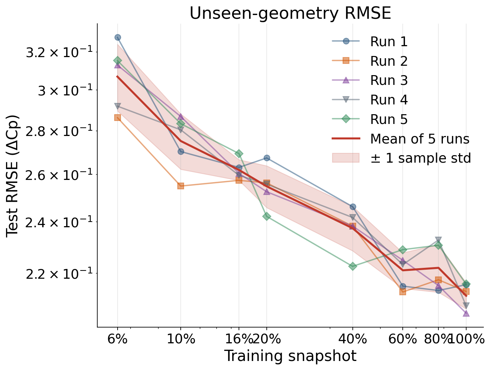
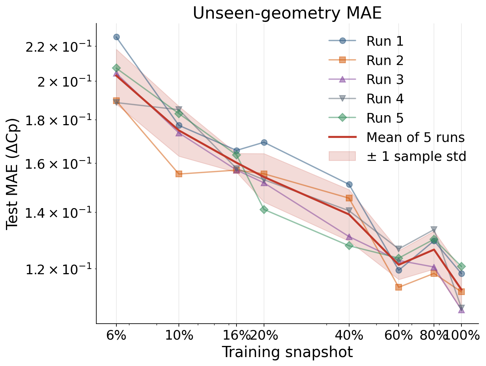
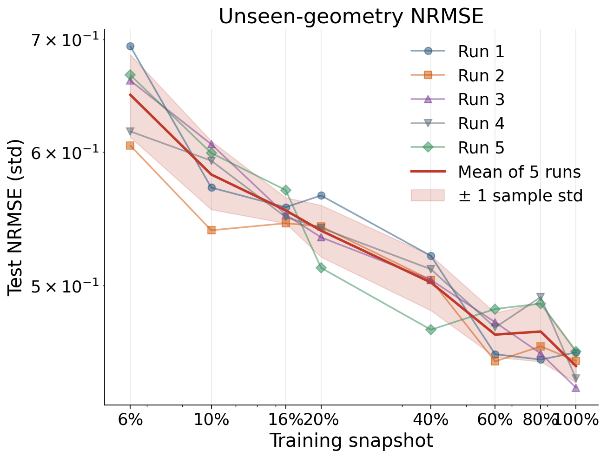

# Multi-fidelity scaling (batch size / LR Optuna)

Updated 2026-11-18T21:27:47.

Each point is the Optuna winner for that nested snapshot. Optuna minimized training-geometry holdout RMSE; batch size and learning rate were searched around the scaling-law centers.

Test scores are on `MF-VortexNet/dataset/new_geom/lhs-free-stream` (`*_vortexNetNewGeom.pkl`). Those cases were not used for training or for selecting the checkpoint.

Runs (sorted seed order): Run 1 ← seed 7, Run 2 ← seed 27, Run 3 ← seed 207, Run 4 ← seed 353, Run 5 ← seed 3407.

## Figures

### Unseen-geometry RMSE

### Unseen-geometry MAE

### Unseen-geometry NRMSE

## Mean test error

| Snapshot | Cases | Fit / holdout | Runs | Test RMSE | Test MAE | Test NRMSE(std) |
|---:|---:|---:|---:|---:|---:|---:|
| 6% | 36 | 25 / 11 | 5 | 0.3068 ± 0.0173 | 0.2030 ± 0.0151 | 0.6489 ± 0.0366 |
| 10% | 60 | 42 / 18 | 5 | 0.2751 ± 0.0129 | 0.1749 ± 0.0118 | 0.5819 ± 0.0272 |
| 16% | 96 | 67 / 29 | 5 | 0.2620 ± 0.0046 | 0.1602 ± 0.0041 | 0.5541 ± 0.0097 |
| 20% | 120 | 84 / 36 | 5 | 0.2548 ± 0.0090 | 0.1541 ± 0.0101 | 0.5389 ± 0.0191 |
| 40% | 240 | 168 / 72 | 5 | 0.2374 ± 0.0089 | 0.1391 ± 0.0097 | 0.5021 ± 0.0189 |
| 60% | 360 | 252 / 108 | 5 | 0.2210 ± 0.0067 | 0.1213 ± 0.0048 | 0.4675 ± 0.0141 |
| 80% | 480 | 336 / 144 | 5 | 0.2220 ± 0.0090 | 0.1264 ± 0.0065 | 0.4695 ± 0.0190 |
| 100% | 600 | 420 / 180 | 5 | 0.2117 ± 0.0047 | 0.1134 ± 0.0061 | 0.4478 ± 0.0099 |

## Test RMSE by run

| Snapshot | Run 1 | Run 2 | Run 3 | Run 4 | Run 5 |
|---:|---:|---:|---:|---:|---:|
| 6% | 0.3278 (trial 004) | 0.2862 (trial 004) | 0.3128 (trial 004) | 0.2918 (trial 012) | 0.3152 (trial 016) |
| 10% | 0.2702 (trial 005) | 0.2549 (trial 005) | 0.2868 (trial 010) | 0.2804 (trial 012) | 0.2833 (trial 005) |
| 16% | 0.2631 (trial 001) | 0.2574 (trial 016) | 0.2604 (trial 007) | 0.2596 (trial 015) | 0.2693 (trial 010) |
| 20% | 0.2673 (trial 017) | 0.2563 (trial 015) | 0.2525 (trial 000) | 0.2557 (trial 013) | 0.2422 (trial 016) |
| 40% | 0.2462 (trial 019) | 0.2382 (trial 001) | 0.2382 (trial 013) | 0.2417 (trial 013) | 0.2225 (trial 015) |
| 60% | 0.2152 (trial 011) | 0.2131 (trial 011) | 0.2248 (trial 012) | 0.2232 (trial 011) | 0.2289 (trial 014) |
| 80% | 0.2136 (trial 005) | 0.2175 (trial 017) | 0.2154 (trial 012) | 0.2327 (trial 015) | 0.2306 (trial 005) |
| 100% | 0.2157 (trial 017) | 0.2133 (trial 014) | 0.2056 (trial 018) | 0.2081 (trial 014) | 0.2160 (trial 015) |

## Holdout / validation RMSE by run

| Snapshot | Run 1 | Run 2 | Run 3 | Run 4 | Run 5 |
|---:|---:|---:|---:|---:|---:|
| 6% | 0.2340 | 0.3446 | 0.2700 | 0.2931 | 0.3817 |
| 10% | 0.2740 | 0.2856 | 0.2315 | 0.2757 | 0.2986 |
| 16% | 0.2523 | 0.2827 | 0.2651 | 0.2312 | 0.2956 |
| 20% | 0.2768 | 0.2359 | 0.2712 | 0.2207 | 0.2287 |
| 40% | 0.2296 | 0.2346 | 0.2268 | 0.2261 | 0.2310 |
| 60% | 0.2096 | 0.2069 | 0.2220 | 0.2240 | 0.2151 |
| 80% | 0.2020 | 0.2035 | 0.1892 | 0.2183 | 0.2153 |
| 100% | 0.2098 | 0.2035 | 0.1953 | 0.1958 | 0.2015 |

## Files

- Figure: `figures/test_rmse_vs_training_snapshots.png`
- Figure: `figures/test_mae_vs_training_snapshots.png`
- Figure: `figures/test_nrmse_std_vs_training_snapshots.png`
- Mean table: `seed_average.csv`
- One row per run and snapshot: `per_seed.json`

