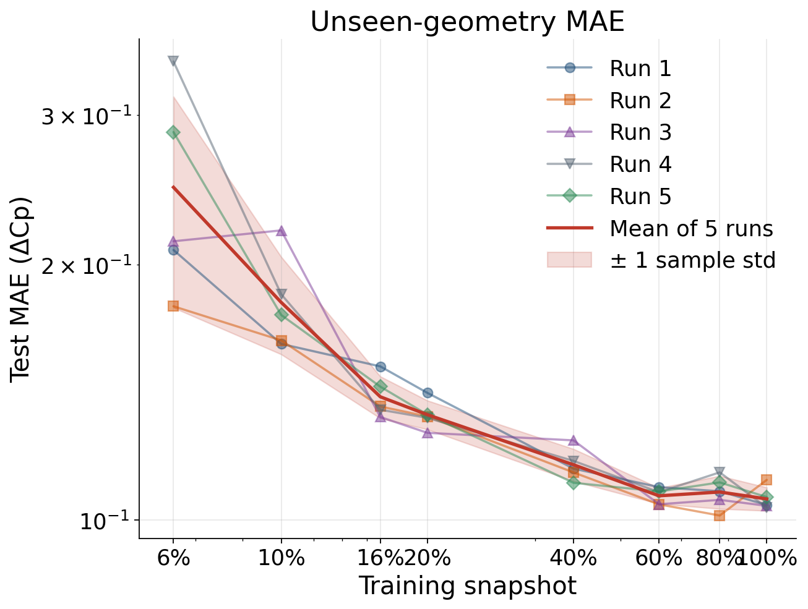
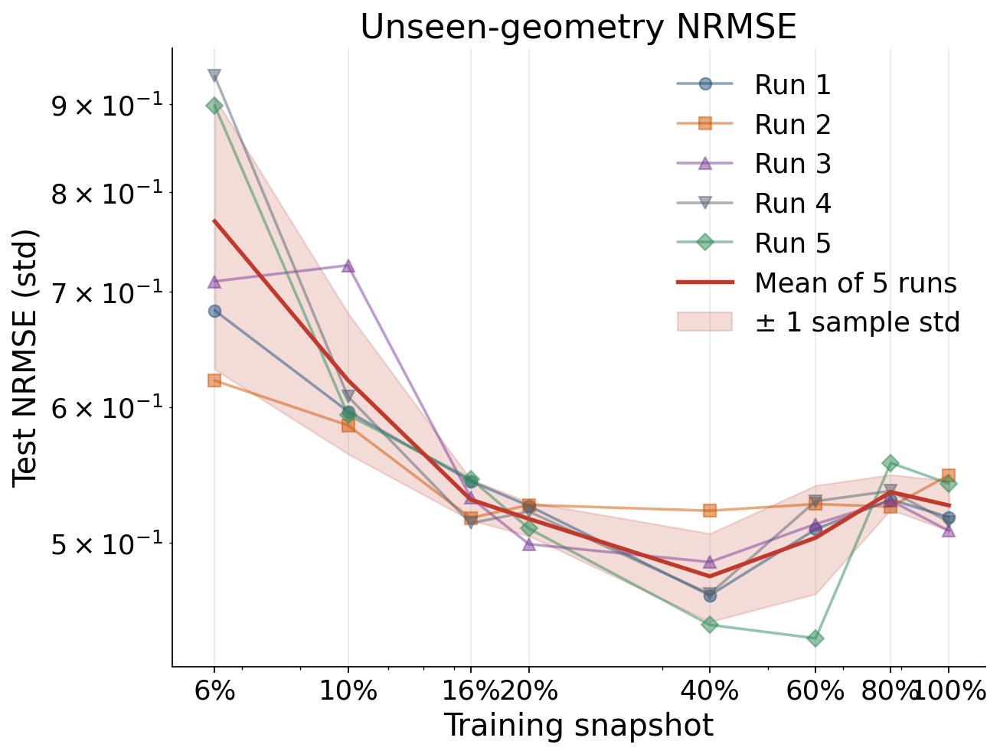

# Multi-fidelity scaling (fixed hyperparameters)

Updated 2026-11-18T21:27:46.

Each point is the trained MF model for that nested snapshot. Hyperparameters are fixed; the training-geometry holdout RMSE is reported but does not select among Optuna trials.

Test scores are on `MF-VortexNet/dataset/new_geom/lhs-free-stream` (`*_vortexNetNewGeom.pkl`). Those cases were not used for training or for selecting the checkpoint.

Runs (sorted seed order): Run 1 ← seed 7, Run 2 ← seed 27, Run 3 ← seed 207, Run 4 ← seed 353, Run 5 ← seed 3407.

## Figures

### Unseen-geometry RMSE

### Unseen-geometry MAE

### Unseen-geometry NRMSE

## Mean test error

| Snapshot | Cases | Fit / holdout | Runs | Test RMSE | Test MAE | Test NRMSE(std) |
|---:|---:|---:|---:|---:|---:|---:|
| 6% | 36 | 25 / 11 | 5 | 0.3639 ± 0.0655 | 0.2467 ± 0.0688 | 0.7696 ± 0.1386 |
| 10% | 60 | 42 / 18 | 5 | 0.2940 ± 0.0277 | 0.1805 ± 0.0237 | 0.6219 ± 0.0585 |
| 16% | 96 | 67 / 29 | 5 | 0.2506 ± 0.0069 | 0.1397 ± 0.0079 | 0.5300 ± 0.0145 |
| 20% | 120 | 84 / 36 | 5 | 0.2442 ± 0.0055 | 0.1331 ± 0.0052 | 0.5165 ± 0.0117 |
| 40% | 240 | 168 / 72 | 5 | 0.2261 ± 0.0134 | 0.1162 ± 0.0051 | 0.4782 ± 0.0282 |
| 60% | 360 | 252 / 108 | 5 | 0.2381 ± 0.0173 | 0.1068 ± 0.0023 | 0.5036 ± 0.0365 |
| 80% | 480 | 336 / 144 | 5 | 0.2532 ± 0.0059 | 0.1079 ± 0.0048 | 0.5354 ± 0.0125 |
| 100% | 600 | 420 / 180 | 5 | 0.2486 ± 0.0083 | 0.1059 ± 0.0033 | 0.5259 ± 0.0175 |

## Test RMSE by run

| Snapshot | Run 1 | Run 2 | Run 3 | Run 4 | Run 5 |
|---:|---:|---:|---:|---:|---:|
| 6% | 0.3229 | 0.2939 | 0.3357 | 0.4420 | 0.4248 |
| 10% | 0.2820 | 0.2768 | 0.3430 | 0.2877 | 0.2807 |
| 16% | 0.2569 | 0.2445 | 0.2512 | 0.2428 | 0.2577 |
| 20% | 0.2485 | 0.2488 | 0.2361 | 0.2466 | 0.2411 |
| 40% | 0.2204 | 0.2469 | 0.2305 | 0.2209 | 0.2119 |
| 60% | 0.2408 | 0.2491 | 0.2425 | 0.2501 | 0.2081 |
| 80% | 0.2506 | 0.2482 | 0.2502 | 0.2535 | 0.2632 |
| 100% | 0.2447 | 0.2589 | 0.2403 | 0.2432 | 0.2560 |

## Holdout / validation RMSE by run

| Snapshot | Run 1 | Run 2 | Run 3 | Run 4 | Run 5 |
|---:|---:|---:|---:|---:|---:|
| 6% | 0.3022 | 0.3692 | 0.2908 | 0.3887 | 0.4585 |
| 10% | 0.2784 | 0.2823 | 0.2667 | 0.2692 | 0.3242 |
| 16% | 0.2432 | 0.2769 | 0.2296 | 0.2268 | 0.2833 |
| 20% | 0.2481 | 0.2216 | 0.2329 | 0.2135 | 0.2242 |
| 40% | 0.1926 | 0.1849 | 0.2068 | 0.2015 | 0.1999 |
| 60% | 0.1359 | 0.1090 | 0.1183 | 0.1289 | 0.1929 |
| 80% | 0.1072 | 0.0857 | 0.0932 | 0.0995 | 0.1122 |
| 100% | 0.1091 | 0.0936 | 0.0814 | 0.0996 | 0.0908 |

## Files

- Figure: `figures/test_rmse_vs_training_snapshots.png`
- Figure: `figures/test_mae_vs_training_snapshots.png`
- Figure: `figures/test_nrmse_std_vs_training_snapshots.png`
- Mean table: `seed_average.csv`
- One row per run and snapshot: `per_seed.json`

